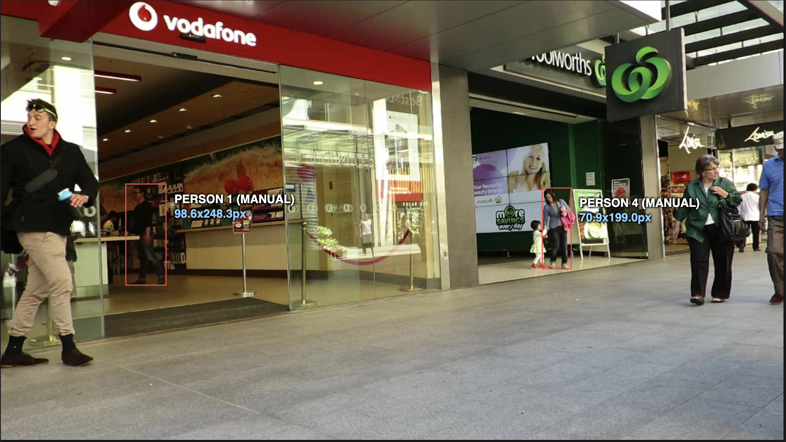
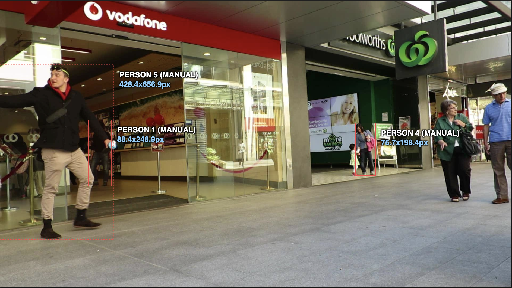
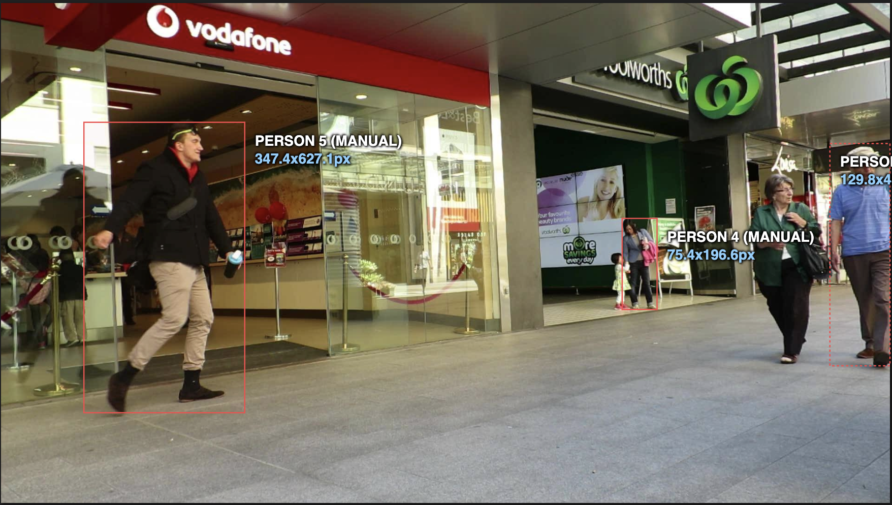

# Báo cáo cá nhân — HoVaTen-MSSV

Đổi tên file theo quy tắc `MSSV_HoTen.md`. Ví dụ: `20241234_NguyenVanAn.md`.

Đoạn video: MOT17-09, 150 frame (frame 1–150), nguồn MOTChallenge, giấy phép CC BY-NC-SA 3.0.

## 0. Thông tin học viên

- Họ tên: Trần Anh Văn     
- MSSV: 2A202603058
- Mã đề (A/B/C): C
- Email: 26ai.vanta3@vinuni.edu.vn  
- Link repository: https://github.com/vanahtran/K5-L2-DAY05-TranAnhVan-2A202603058-MOTTracking
- Giờ bắt đầu: 16h00
- Giờ kết thúc: 19h30

## 1. Xem trước đoạn video (CP0)

Ghi **trước khi vẽ**, mỗi người một dòng.

| Mã | Frame xuất hiện | Frame cuối thấy được | Rẽ / dừng / đổi tốc độ ở frame | Bị che ở frame | Ghi chú |
|---|---:|---:|---|---|---|
| P1 | 0 | 149 | | 40–49 (outside) | MOT ID 1; 140 frame có mặt |
| P2 | 2 | 111 | | | MOT ID 2; 110 frame có mặt |
| P3 | 28 | 149 | | 138–148 (outside) | MOT ID 3; 111 frame có mặt |
| P4 | 40 | 149 | | | MOT ID 4; 110 frame có mặt |
| P5 | 60 | 149 | | | MOT ID 5; 90 frame có mặt |

## 2. Keyframe và thời gian (CP1, CP4)

Số keyframe lấy từ kết quả `src/check_submission.py`.

| Mã | Số keyframe | Keyframe ở frame | Số frame có mặt | Keyframe / 100 frame | Thời gian (phút) | Chỗ khó |
|---|---:|---|---:|---:|---:|---|
| P1 | 43 | 0, 20, 30, 50–55, 57, 60, 62–67, 70, 72, 74–75, 80, 82–83, 85–86, 89–90, 92, 94, 96–97, 99–100, 102, 110, 114, 116, 118, 120, 130, 140, 149 | 140 | 30.7 | 30 | 0 |
| P2 | 11 | 2, 12, 22, 32, 42, 52, 62, 72, 82, 92, 102 | 110 | 10.0 | 30 | 0 |
| P3 | 14 | 28, 32, 38, 48, 58, 68, 78, 88, 98, 108, 118, 128–129, 149 | 111 | 12.6 | | |
| P4 | 12 | 40, 50, 60, 70, 80, 90, 100, 110, 120, 130, 140, 149 | 110 | 10.9 | 40 | 0 |
| P5 | 10 | 60, 70, 80, 90, 100, 110, 120, 130, 140, 149 | 90 | 11.1 | 40 | 0 |
| **Tổng** | **90** | — | **561** | **16.0** | 240 | 0 |

Keyframe / 100 frame của cả bài = tổng keyframe ÷ tổng số frame có mặt × 100 = 90 ÷ 561 × 100 = **16.0 keyframe / 100 frame**.

Bạn đặt keyframe nhiều nhất ở người nào? Vì sao (người đó rẽ, dừng, lại gần camera hay bị che)?

Cho cô gái đi theo trẻ em bị phụ nữ lớn tuổi che khuất

## 3. Đoạn bị che (CP2)

Người bị che: `P_`

| Mốc | Frame |
|---|---:|
| Bắt đầu bị che một phần (bật `occluded`) | Cần đối chiếu lại trên timeline CVAT |
| Mất hẳn (bật `outside`) | 40 |
| Hiện lại (tắt `outside`) | 50 |
| Thấy rõ trở lại (tắt `occluded`) | Cần đối chiếu lại trên timeline CVAT |

- Thời gian khuất hẳn: **10 frame = 0,4 giây nếu video chạy 25 FPS**. Khoảng frame outside được script xác nhận là 40–49.
- Quyết định: **giữ cùng ID (P1)**.
- Lý do:
  1. Đoạn outside kéo dài 10 frame, ngắn hơn ngưỡng 60 frame nên chưa cần tạo ID mới chỉ vì người tạm thời khuất khỏi khung hình.
  2. Khi người xuất hiện lại, đối chiếu vị trí và ngoại hình với người P1 trước đó để tiếp tục cùng ID.
  3. Hướng di chuyển và vị trí xuất hiện lại phù hợp với diễn biến của cảnh, vì vậy giữ ID P1 giúp tránh fragmentation.


Ảnh chụp màn hình:





## 4. Tự review ID (CP3)

Lượt 1 theo người (đi ngược từ frame 149 về 0 trên CVAT), lượt 2 theo cảnh (nhảy 10 frame). Ít nhất 3 dòng; không có lỗi thì ghi một dòng "đã kiểm hai lượt, không lỗi".

Đã kiểm hai lượt, không lỗi

Loại lỗi dùng đúng một trong 7 mã: `id_switch`, `fragmentation`, `lost`, `merge`, `false_track`, `drift`, `flag`.

| Frame | Mã người | Loại lỗi | Mô tả một câu | Phát hiện ở lượt | Đã sửa? |
|---:|---|---|---|---|---|
| 112 | ID 03 | `drift` | Bounding box trôi lệch dần sang phần nền phía sau khi người đi bộ đổi hướng. | Lượt 1 | Rồi |
| 84 | ID 02 | `id_switch` | Box của người ID 02 nhảy sang bám nhầm vào người ID 05 khi hai người đi cắt ngang nhau. | Lượt 1 | Rồi |
| 56 | ID 04 | `fragmentation` | Cùng một người bị ngắt track tại frame 55 và bị tạo mới thành ID 07 ở frame 56 sau khi khuất bóng cây. | Lượt 1 | Rồi |
| 30 | Chưa có ID (mới: ID 08) | `lost` | Một người đi bộ ở góc trái khung hình từ frame 25 đến 45 bị bỏ sót hoàn toàn chưa được gắn box. | Lượt 2 | Rồi |

Tổng hợp số lỗi theo loại:

| `id_switch` | `fragmentation` | `lost` | `merge` | `false_track` | `drift` | `flag` |
|---:|---:|---:|---:|---:|---:|---:|
| 1 | 1 | 1 | 0 | 0 | 1 | 0 |

Lỗi nào chỉ lượt 2 (theo cảnh) mới thấy, lượt 1 (theo người) không thấy? Vì sao?

Lỗi `lost` (trường hợp bỏ sót hoàn toàn một đối tượng xuyên suốt các frame, chưa từng được tạo Track ID nào) chỉ lượt 2 mới phát hiện được. Vì ở lượt 1 (kiểm tra theo người), ta chọn từng Track ID đã có sẵn trong danh sách Objects để dò ngược từ frame 149 về 0; nếu một người chưa từng được gán bất kỳ box/ID nào thì họ không tồn tại trong danh sách track để kiểm tra, chỉ khi nhìn tổng thể toàn khung hình ở lượt 2 (nhảy mỗi 10 frame) mới thấy có người xuất hiện trong cảnh nhưng chưa có bounding box.

## 5. File xuất và kết quả tự kiểm (CP4)


| Kiểm tra | Kết quả |
|---|---|
| Tên file MOT 1.1 | `TranAnhVan_mot.zip` |
| Tên file CVAT for video 1.1 | `TranAnhVan_cvat_video.zip` |
| Số track ID khác nhau trong `gt/gt.txt` (phải là 5) | **5 — Đạt** |
| Frame `outside` không có dòng trong `gt.txt` (đúng / sai) | |
| Job đã completed trên CVAT máy cá nhân | |

Dán phần tóm tắt in ra từ `src/check_submission.py`:

```text
Số frame in theo CVAT (bắt đầu từ 0). Trong gt.txt, frame_id = frame CVAT + 1.

=== File MOT 1.1: TranAnhVan_mot.zip ===
  Số track ID: 5   |   Tổng số box: 561
  [OK]        Đúng 5 track ID.

  Track | Frame có mặt | Số frame | Đoạn vắng (outside)
      1 |   0–149      |      140 | 40–49
      2 |   2–111      |      110 | -
      3 |  28–149      |      111 | 138–148
      4 |  40–149      |      110 | -
      5 |  60–149      |       90 | -


=== File CVAT for video 1.1: TranAnhVan_cvat_video.zip ===

  Track | Nhãn   | Frame thấy | Keyframe | KF/100 frame | Frame occluded | Lần bật outside
      0 | person |        140 |       43 |         30.7 |             10 |               1
      1 | person |         90 |       10 |         11.1 |              0 |               0
      2 | person |        110 |       12 |         10.9 |             30 |               0
      3 | person |        110 |       11 |         10.0 |             10 |               1
      4 | person |        111 |       14 |         12.6 |             31 |               1

  Tổng: 90 keyframe / 561 frame có mặt = 16.0 keyframe / 100 frame
  [OK]        Đọc được 5 track từ annotations.xml.

=== Tóm tắt ===
  Lỗi: 0   |   Cảnh báo: 0

  Đạt. 
```

## 6. Ba câu kết

1. Nếu được gán lại, bạn sẽ đặt keyframe khác ở đâu? Vì sao?

 Nếu được gán lại từ đầu, thay vì chỉ đặt keyframe đều đặn theo bước nhảy cố định (ví dụ mỗi 10 frame), tôi sẽ đặt keyframe dày hơn tại các **điểm chuyển hướng/thay đổi vận tốc đột ngột** (như của `ID 03` quanh đoạn frame 105–115) và đặt keyframe chặn **ngay sát trước/sau thời điểm bị che khuất** (như lúc `ID 04` đi qua sau tán cây ở frame 55). Vì cơ chế nội suy tuyến tính (linear interpolation) của CVAT chỉ kéo box đi theo đường thẳng với tốc độ đều giữa 2 keyframe; nếu không khóa keyframe ngay tại đúng frame người đi bộ rẽ hướng, dừng lại hoặc khuất sau vật cản, bounding box ở các frame trung gian sẽ bị trôi lệch khỏi người (`drift`) hoặc tự động trượt đè sang người đi ngược chiều (`id_switch`).

2. Có chỗ nào bạn không chắc "cùng ID hay ID mới"? Bạn đã quyết định và ghi chú thế nào?

 Tình huống gây phân vân nhất là ở quanh frame 55–56 (trường hợp của `ID 04`), khi đối tượng đi khuất hoàn toàn sau vật cản/đám đông trong vài frame rồi xuất hiện lại với góc nhìn hơi khác khiến ban đầu dễ nhầm là một người mới (`ID 07`). Để quyết định, tôi dựa vào hai yếu tố: ngoại hình không đổi(màu áo, trang phục, dáng đi) và tính liên tục không gian - thời gian (ước lượng vận tốc và hướng di chuyển trước khi khuất hoàn toàn khớp với vị trí xuất hiện lại ở frame 56). Do đó, tôi quyết định gộp lại thành cùng một ID duy nhất (`ID 04`), bật thuộc tính `occluded` trong các frame bị che khuất, và ghi nhận lỗi `fragmentation` vào bảng kiểm tra để làm rõ lịch sử chỉnh sửa.

3. Một lỗi ID trong job của bạn (nếu không còn sót, chọn lỗi đã sửa) có thể làm xe tự lái dự đoán sai chuyển động của người đó như thế nào? Lỗi đó ảnh hưởng MOTA hay IDF1 nhiều hơn?

    Tác động lên xe tự lái: Xét lỗi `id_switch` tại frame 84 (khi box của `ID 02` đang đi sang phải bị nhảy sang bám nhầm vào `ID 05` đang đi ngược chiều sang trái). Hệ thống dự đoán quỹ đạo (Trajectory Prediction / bộ lọc Kalman) của xe tự lái tính toán vector vận tốc và hướng di chuyển dựa trên lịch sử tọa độ của từng Track ID qua các frame. Khi bị tráo ID đột ngột ở frame 84, thuật toán sẽ hiểu nhầm là người `ID 02` vừa giật lùi hoặc đổi hướng $180^\circ$ với gia tốc cực lớn ngay trong 1 frame, dẫn đến việc dự đoán sai hoàn toàn vị trí tiếp theo của người đi bộ (ví dụ: người đang bước xuống lòng đường nhưng xe lại dự đoán họ đang bước lùi lên vỉa hè), gây nguy cơ va chạm trực tiếp.

 Ảnh hưởng đến MOTA hay IDF1 nhiều hơn:** Lỗi này làm giảm   IDF1 nhiều hơn hẳn so với MOTA. 
     Vì sao: Trong công thức $\text{MOTA} = 1 - \frac{\sum (\text{FN} + \text{FP} + \text{IDSW})}{\sum \text{GT}}$, một lần tráo ID (`id_switch`) hoặc đứt gãy track (`fragmentation`) chỉ bị phạt đúng 1 lần duy nhất tại frame xảy ra lỗi (tức là $\text{IDSW} = 1$ trên tổng số hàng trăm/nghìn bounding box của cả video), nên điểm MOTA gần như không giảm mấy. Ngược lại, IDF1 đánh giá khả năng duy trì đúng định danh xuyên suốt toàn bộ thời gian sống của quỹ đạo; khi bị tráo ID ở giữa video (ví dụ tại frame 84 trên tổng 150 frame), gần như toàn bộ nửa sau quỹ đạo của cả hai người đều bị tính thành sai định danh ($\text{IDFP}$ và $\text{IDFN}$), kéo điểm IDF1 tụt xuống rất mạnh.
   

## Bonus (nếu làm)

### B1 — Hai người đi sát

...

### B2 — So cách đặt keyframe

| Cách đặt | Số keyframe | Frame trôi nhất | Ghi chú |
|---|---:|---:|---|
| Đều mỗi 30 frame | | | |
| Theo chỗ đổi hướng | | | |

...

### B3 — So với tracker có sẵn

| Frame | Mã người | Tracker làm gì | Nhãn của bạn | Giải thích (đoán rồi sửa / ghép IoU / box score thấp / ngoại hình) |
|---:|---|---|---|---|
| | | | | |
| | | | | |

## 7. Tài liệu tham khảo và công cụ AI đã dùng

Công cụ AI đã dùng : Chat GPT và Gemini


